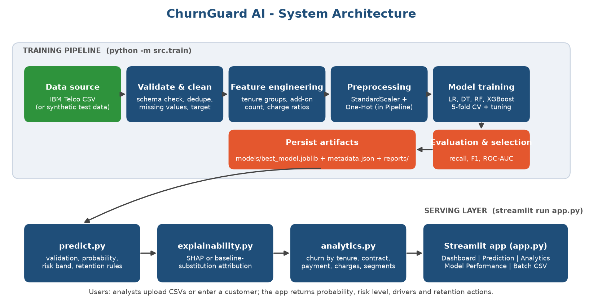

# ChurnGuard AI - Intelligent Customer Churn Prediction and Retention Intelligence System

**Live demo:** https://churn-guard-ai-2005.streamlit.app/  
(free hosting: the first load after idle can take 30-60 seconds)

End-to-end machine learning project: data validation and cleaning, feature engineering, four
compared models (Logistic Regression, Decision Tree, Random Forest, XGBoost), evaluation focused on
recall / F1 / ROC-AUC, explainability, retention recommendations and a five-page Streamlit dashboard.

> **Read this first - synthetic data.** The bundled models, figures, report and slides were produced
> on a **synthetic** dataset with the IBM Telco schema, because the build environment had no internet
> access to download the real file. They show that the pipeline works, **not** real-world performance.
> To get genuine results: put the real CSV in `data/raw/` (see [docs/DATASET.md](docs/DATASET.md)),
> run `python -m src.train`, then `python scripts/build_all.py`.
>
> Also not verified in the build environment: **XGBoost, SHAP and Streamlit were not installable**.
> The code uses XGBoost/SHAP automatically when installed and falls back to scikit-learn gradient
> boosting / a model-agnostic attribution otherwise (labelled everywhere). The Streamlit app was
> smoke-tested with a stubbed Streamlit only - please run it once yourself and capture screenshots.

## Features
- **Dashboard** - total customers, predicted churners, churn %, high-risk count, hold-out metrics
- **Customer Prediction** - probability, Low/Medium/High risk, top drivers, retention actions
- **Analytics** - churn by tenure, contract, payment method, monthly charges, segments (filterable)
- **Model Performance** - comparison, confusion matrix, ROC/PR curves, importance, explanations
- **Batch Prediction** - upload CSV, validation messages, download predictions

## Architecture


```
churn-guard-ai/
  app.py                 Streamlit dashboard
  requirements.txt  README.md  .gitignore
  config/                settings.py (paths, params), schema.py (expected columns/values)
  data/  raw/ synthetic/ processed/
  models/                best_model.joblib, metadata.json, background.csv
  notebooks/             01_pipeline_walkthrough.ipynb
  src/                   data_loader, data_generation, preprocessing, feature_engineering,
                         train, predict, evaluation, explainability, analytics, eda
  tests/                 unit tests + Streamlit-stub smoke test
  reports/               PDF report, PPTX, metrics CSVs, figures/
  assets/                architecture.png
  docs/                  DATASET, MODEL_EVALUATION, GITHUB_PUBLISHING, scripts for talk/video
  scripts/               build_all, build_report, build_presentation, build_docs, diagram
```

## Setup
Requires Python 3.11+.
```bash
python -m venv .venv
source .venv/bin/activate          # Windows: .venv\Scripts\activate
pip install -r requirements.txt
```

## Run
```bash
# 1. Data: real CSV in data/raw/ (docs/DATASET.md)  -- or synthetic for testing only:
python -m src.train --generate-synthetic     # synthetic data + training
python -m src.train                          # real data if present (else existing synthetic file)
python -m src.train --n-iter 20              # larger hyper-parameter search

# 2. Dashboard
streamlit run app.py

# 3. Tests
python -m unittest discover -s tests -t .    # or: pytest

# 4. Report, slides, evaluation doc (regenerated from real artifacts)
python scripts/build_all.py --author "Your Name" --institution "Your College"
```
If no model/data exists, the app shows setup instructions (with a one-click synthetic-data trainer)
and the CLI prints exactly what to do.

## Method summary
Cleaning (duplicates, blank TotalCharges, target mapping) -> IQR outlier analysis -> feature
engineering (add-on count, month-to-month, auto-pay, no-protection, charge ratio, tenure group) ->
scaling + one-hot inside a scikit-learn Pipeline (no leakage) -> stratified 80/20 split ->
randomised search with stratified 5-fold CV (refit on F1) -> best model chosen by the mean of
CV recall, F1 and ROC-AUC -> hold-out evaluation. Imbalance is handled with class weights.
Details and numbers: [docs/MODEL_EVALUATION.md](docs/MODEL_EVALUATION.md).

## Screenshots
No screenshots are included, because the app could not be launched in the build environment and
fake screenshots would be misleading. After `streamlit run app.py`, capture each page into
`assets/screenshots/` and link them here.

## Limitations
Single static dataset; no temporal validation; association not causation; retention actions are
heuristics, not tested interventions; probabilities uncalibrated; 0.50 threshold not cost-optimised;
dashboard counts score the training population; no fairness audit; bundled results are synthetic.

## Future enhancements
Train on real data and compare; cost-sensitive thresholding; calibration and uplift modelling; drift
monitoring; fairness audit; FastAPI service, Docker and CI.

## Publishing
See [docs/GITHUB_PUBLISHING.md](docs/GITHUB_PUBLISHING.md). References in the report should be
verified against the originals (page numbers, venues) before academic submission, and the literature
review extended with papers you have read yourself.

## Dataset credit
IBM Telco Customer Churn sample dataset (IBM Sample Data Sets; Kaggle and Hugging Face mirrors).
